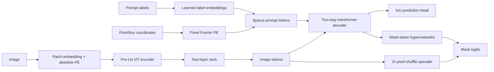

# TinySAM, built from scratch

This is a teaching implementation of promptable segmentation. The model has
two independent implementations: **NumPy**, with manually derived backward
passes for every trainable layer, and **PyTorch**, whose custom layers use only
`nn.Parameter` and elementary tensor operations so autograd can differentiate
the same equations. There are no pretrained weights in either model.

## Why TinySAM is small

The published EfficientSAM training recipe is far beyond a student laptop: its
SAMI stage distills image features from a frozen SAM ViT-H teacher on
ImageNet-1K, then fine-tunes on SA-1B. The teacher and large-scale mask data
make that a multi-GPU workload. This project has no teacher and trains on
Oxford-IIIT Pets instead. The NumPy model uses 64×64 images and the PyTorch
model uses 256×256 images. The latter is intended for a free Colab GPU; the
NumPy demo and small model are practical on a CPU. These changes make the
learning process tractable, not equivalent in quality to SAM or EfficientSAM.

SAMI normally learns to reproduce teacher features. Our MAE stage instead
reconstructs normalized pixels in masked patches: that is the standard
masked-autoencoder objective and an honest from-scratch substitute when no
frozen SAM teacher is available.

## Part 0: warm-up algorithms

Before building TinySAM, review the ideas in `warmup/` with small, seeded
NumPy examples. From the repository root, run:

```bash
python from_scratch/warmup/perceptron.py
python from_scratch/warmup/knn.py
python from_scratch/warmup/pca_svd.py
python from_scratch/warmup/pca_svd.py --pets
```

Each script saves a plot in `from_scratch/runs/warmup/`; `--show` also opens
the figure, and PCA's optional `--pets` mode skips cleanly if the 64-pixel
training cache is missing. The perceptron update is a concrete linear-layer
weight update, while logistic regression makes the TinySAM backprop starting
point explicit: for a logit `z`, binary cross-entropy gives
`∂L/∂z = sigmoid(z) − y`. KNN's vectorized squared distances use dot products,
the same family of similarities used by attention (attention normalizes
query–key similarities before taking a weighted value sum). PCA/SVD teaches
projection onto learned directions and low-rank matrix factorization, which
helps explain embeddings and the linear projections in TinySAM.

## Model at a glance

```text
RGB image ─ Patch split/Linear ─ ViT encoder ─ neck ─ image tokens ─┐
                                                                   │
point/box coords ─ Fourier PE + label vectors ─ sparse prompt tokens
                                                                   ▼
          learned IoU/mask tokens ─ two-way transformer ────────────┤
                                                                   ├─ IoU MLP
image tokens ─ 2× pixel-shuffle upscaler ──────────────┐            │
                                                      └─ hypernets ─ masks
```



The public call is `model(images, points, labels)`, where images are
`(B,3,S,S)`, points `(B,N,2)` in `(x,y)` image pixels, and labels `(B,N)`:
1 means a positive point, 0 a negative point, 2/3 the top-left/bottom-right
corners of a box, and −1 padding. It returns mask logits `(B,K,4Hp,4Hp)` and
IoU estimates `(B,K)`. `encode_image(images)` and `decode(embedding, points,
labels)` can be called separately to cache an image representation in the
interactive app.

| Preset | S | P | Encoder (D, depth, heads) | Decoder E / depth / heads | Masks | Parameters |
|---|---:|---:|---|---|---:|---:|
| `NUMPY_TINY` | 64 | 8 | 64 / 4 / 4 | 64 / 2 / 4 | 3 | 416,091 |
| `TORCH_SMALL` | 256 | 16 | 192 / 6 / 3 | 128 / 2 / 4 | 3 | 3,662,707 |

Counts include every trainable parameter and can be recomputed without loading
data. `Hp=S/P`; mask logits are 32×32 and 64×64 for
the two presets. Training targets use area averaging followed by a 0.5
threshold at this resolution; inference upsamples logits to the input size.

## Equations and reverse-mode derivatives

All feature vectors are row vectors in these equations. The implementations
use the same equations and the NumPy docstrings call out their derivatives.

### Linear and normalization

For `Y=XW+b`, `W∈R^(I×O)`:

```text
dX = dY Wᵀ
dW = Xᵀ dY                 (sum over batch/sequence positions)
db = Σ dY
```

LayerNorm operates on the last axis, with population variance:
`x̂=(x−μ)/sqrt(σ²+ε)`, `y=γx̂+β`. Let `g=dY⊙γ`, and let the normalized width
be `d`. Then:

```text
dβ = Σ dY                  dγ = Σ(dY⊙x̂)
dX = inv_std · (g − mean(g) − x̂·mean(g⊙x̂))
```

`LayerNorm2d` applies the same operation over channels independently at each
pixel. Patch embedding reshapes non-overlapping `P×P` RGB blocks into vectors
of length `3P²` and applies the linear map; its backward applies `Wᵀ` then
reverses the reshape. This is equivalent to a stride-`P` convolution with
kernel `P`.

### GELU, ReLU, and softmax

Both GELU implementations use the explicit tanh approximation:

```text
c = sqrt(2/π)                u = c(x + 0.044715x³)
GELU(x) = 0.5x(1+tanh(u))
dGELU/dx = 0.5(1+tanh(u))
          + 0.5x(1−tanh²(u))c(1+3·0.044715x²)
```

ReLU is `max(0,x)` and its derivative is `1[x>0]`. Stable softmax subtracts
the row maximum before exponentiating. Its Jacobian-vector product is
`dS = p⊙(dp−Σ(dp⊙p))`; neither implementation calls a framework softmax.

### Attention and transformer blocks

For each head, `Q=XWq`, `K=XWk`, `V=XWv`,
`S=QKᵀ/sqrt(dh)`, `P=softmax(S)`, and `O=PV`, followed by an output projection.
Writing `C=PV`:

```text
dV = Pᵀ dC                 dP = dC Vᵀ
dS = P⊙(dP − Σ(dP⊙P))
dQ = dS K / sqrt(dh)       dK = dSᵀ Q / sqrt(dh)
```

Projection gradients are the linear-layer equations above. The image encoder
uses pre-LayerNorm residual blocks:
`x←x+Attention(LN(x)); x←x+MLP(LN(x))`. The decoder follows the SAM-style
post-normalized order: token self-attention, token-to-image attention,
two-layer ReLU MLP, then image-to-token attention, each with residual and
LayerNorm; a final token-to-image attention and residual LayerNorm follows.
Its feed-forward module uses width `2E`; the image ViT MLP uses `4D`.

### Prompt Fourier features

The Gaussian frequency matrix `G∈R^(2×E/2)` is fixed after a seeded draw.
Coordinates receive the half-pixel offset, are normalized by image height and
width, mapped to `u=2c−1`, then embedded as
`[sin(2πuG), cos(2πuG)]`. If coordinate gradients were needed, for each
frequency component `a=(uG)j`:

```text
d sin(2πa)/dc = 4π Gᵀ cos(2πa)
d cos(2πa)/dc = −4π Gᵀ sin(2πa)
```

Prompt coordinates are inputs rather than trainable values here, so the NumPy
backward stops at the fixed Fourier embedding. The learned label-vector
gradient is the sum of token gradients for each label. Padding uses its
learned invalid vector and has zero positional encoding. Dense image-grid
Fourier features are evaluated at patch centers.

### 2× upscaler and hypernetworks

For the specified kernel=stride=2 transposed convolution, there is no overlap:
each input pixel is linearly mapped from `Cin` to `4·Cout`, reshaped into
`(Cout,2,2)`, and pixel-shuffled. Backward first applies the inverse shuffle
and then the linear derivatives. The mask feature path is
`E → E/4 → LayerNorm2d → GELU → E/8 → GELU`. Each mask token generates its
per-channel mask weight through three maps `E→E→E→E/8` with ReLU between;
the mask is `mask[b,k,y,x]=Σc weight[b,k,c]·feature[b,c,y,x]`. The IoU head
uses the same three-map/ReLU pattern with final width `K`.

### Losses and optimizer

For probability `p=sigmoid(z)`, target `y`, `pt=yp+(1−y)(1−p)`,
`αt=αy+(1−α)(1−y)`, and binary cross-entropy `BCE`:

```text
FL = αt(1−pt)^γ BCE
dFL/dz = αt[(1−pt)^γ(p−y) − γ(1−pt)^(γ−1) BCE(2y−1)p(1−p)]
```

The code uses `α=0.25`, `γ=2`, and averages pixels. Soft Dice is
`1−(2Σpy+ε)/(Σp+Σy+ε)`; writing `A=2Σpy+ε`, `B=Σp+Σy+ε`, its derivative is
`dL/dp=−(2yB−A)/B²`, followed by `dp/dz=p(1−p)`. For every sample the K mask
losses are compared and only the lowest-loss mask receives mask gradients.
The mask objective is `20·focal + dice`.

The IoU head target is the detached (constant) binary IoU of each mask after
thresholding logits at zero. Its mean-squared error derivative is
`2(pred−target)/(B·K)`. The batch objective is the mean selected mask loss plus
this IoU MSE.

For each parameter, AdamW uses
`m←β1m+(1−β1)g`, `v←β2v+(1−β2)g²`,
`m̂=m/(1−β1^t)`, `v̂=v/(1−β2^t)`, followed by decoupled decay
`θ←θ(1−lr·wd)−lr·m̂/(sqrt(v̂)+ε)`. Both implementations keep these moment
updates explicit; PyTorch `torch.optim` is not used.

## Data, training, and evaluation

The data module downloads the official Pets image/annotation tarballs into
`data/raw/`, reads `annotations/trainval.txt` and `test.txt`, converts images
to RGB (including CMYK inputs), and uses trimap labels 1 or 3 as foreground.
Resized uint8 arrays are cached under `data/cache/`; ImageNet normalization is
applied when loading an item. Training randomly flips horizontally and samples
either a jittered bbox or up to three positive/negative clicks. `data/` and
`runs/` are ignored by git. Samples whose resized trimap collapses to all
foreground or all background are skipped because they cannot provide both
valid prompt classes.

From the repository root:

```bash
python -m pip install -r from_scratch/requirements.txt
python from_scratch/scripts/download_data.py --size 64
python from_scratch/scripts/train_numpy.py --epochs 10 --batch-size 32 --name pets-numpy
python from_scratch/scripts/evaluate.py --impl numpy \
  --weights from_scratch/runs/pets-numpy/weights.npz --prompt point
python from_scratch/scripts/evaluate.py --impl numpy \
  --weights from_scratch/runs/pets-numpy/weights.npz --prompt box
python from_scratch/scripts/visualize.py --impl numpy \
  --weights from_scratch/runs/pets-numpy/weights.npz
```

For the 256-pixel PyTorch path, download/build a 256 cache and run:

```bash
python from_scratch/scripts/download_data.py --size 256
python from_scratch/scripts/pretrain_mae_torch.py --steps 1000 --batch-size 32
python from_scratch/scripts/train_torch.py --init-encoder from_scratch/runs/mae_encoder.pt
```

The MAE checkpoint contains only `image_encoder.*` tensors. Fine-tuning checks
that every supplied key exists in TinySAM, rejects unexpected keys, and prints
the number of encoder tensors loaded.

The interactive Gradio app runs on CPU:

```bash
python from_scratch/app/app.py --impl numpy --weights from_scratch/app/weights/tinysam_numpy.npz
# Or select the PyTorch backend and its checkpoint:
python from_scratch/app/app.py --impl torch --weights from_scratch/runs/torch-tinysam/weights.pt
```

Choose NumPy/PyTorch, upload an image, and click. The positive/negative toggle
selects point labels; box mode uses two clicks for the corners. `Clear prompts`
resets state. The encoder output is cached for the currently selected image.
If the optional PyTorch demo weights are absent, the app explains how to supply
a trained checkpoint instead of pretending to load one.

### Colab workflow

Open `notebooks/train_colab.ipynb`. It checks for a GPU, clones this branch,
installs requirements, downloads Pets, runs the tests, pretrains the MAE,
trains the 256-pixel model, evaluates point and box prompts, visualizes samples,
shows its loss curve, and downloads the checkpoint. The 2-vCPU VM measurements
are intentionally not presented as Colab GPU performance.

## Correctness tests and measured results

`pytest from_scratch/tests -q` checks all elementary layer inputs/parameters
against centered finite differences, checks the complete NumPy model's
parameter gradients, checks all three losses, and compares the NumPy analytic
gradients against PyTorch autograd after copying parameters. Finite differences
use float64, `eps=1e-5`, and symmetric relative error
`|a−n|/max(|a|+|n|,1e-8)`. The parity test is especially useful: both models
execute the same forward equations, but their backward implementations are
independent. The MAE transfer test checks exact equality for each transferred
encoder tensor; the Part 0 tests cover perceptron convergence, KNN distances
and voting, and PCA power iteration/reconstruction.

Measurements are collected on the available **2-vCPU CPU VM**:

| Run | Hardware | Result |
|---|---|---|
| NumPy train step, batch 32, `NUMPY_TINY` | 2-vCPU VM | 0.270 s |
| PyTorch CPU train step, batch 32, `TORCH_SMALL` | 2-vCPU VM | 1.448 s |
| PyTorch MAE step, batch 32, `TORCH_SMALL` | 2-vCPU VM | 0.499 s |
| Pets run, 110 epochs | 2-vCPU VM | 57m 32s; final train loss 0.46328; validation mIoU 0.2216 → 0.7716 (best, epoch 80) → 0.7368 (final) |
| Pets test mIoU, point / box | 2-vCPU VM | 0.7460 / 0.7603 (3,662 test images) |
| CPU MAE 20-step smoke | 2-vCPU VM | loss 1.658 → 1.202 |
| CPU TinySAM 50-step smoke | 2-vCPU VM | train loss 3.994 → 2.270; 4-image point mIoU 0.2287 |

The full per-epoch validation curve is in
`from_scratch/runs/pets-numpy/val_metrics.csv` (128 validation samples per
epoch); the step losses are in `loss.csv`. The training curve is
`from_scratch/runs/pets-numpy/loss_curve.png`. Deterministic test metrics are
saved separately as `evaluate_numpy_point.json` and `evaluate_numpy_box.json`,
and the eight-image prediction grid is `visualize.png`, all under
`from_scratch/runs/pets-numpy/`. The trained NumPy checkpoint is also committed
for the CPU demo at `from_scratch/app/weights/tinysam_numpy.npz`. Do not infer
test-set performance from a training batch.
